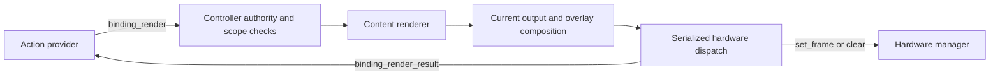

# Deckr Action Runtime rendering v1 specification

This specification defines Action Runtime rendering during alpha development.
It supplements the [Action Runtime specification](deckr-action-runtime.md).
Schemas define structure. The requirements below define content, authority,
ordering, and result semantics.

## Purpose and decisions

An action provider supplies display content. The controller converts that content
to a frame for a selected raster capability. The hardware manager receives only
the existing `set_frame` or `clear` command.

Use two new Action Runtime messages: `binding_render` and
`binding_render_result`. Advertise rendering support in `binding_attached`.
Use the existing service-use agreement and `services` lane. A separate rendering
service, advertisement, agreement profile, or KV view is not necessary.

The baseline supports plain text and inline PNG images. JPEG input is
optional. URL fetching and Invariant graphs are optional, versioned extensions.
The controller owns fonts, rendering workers, caches, and device conversion.
Language cores own the message models and managed service boundary.

This specification does not define animation, video, multi-control transactions,
arbitrary executable code, or a common graph execution engine.

## Existing boundaries

The [raster command contract](deckr-hardware-capabilities.md#raster-bitmap)
defines `set_frame` as base64-encoded PNG or JPEG image bytes. A URL, graph,
data URI, or text string is not a hardware frame.

The [Action Runtime specification](deckr-action-runtime.md) defines service
subjects, controller-owned bindings, output generations, and named capability
matches. Rendering uses those rules. It does not add capabilities to a binding.

The [controller implementation](https://github.com/kws/deckr-controller)
currently has image, URL, and Invariant graph paths, asynchronous workers, and
checks that discard old render results. These paths inform this specification. They
do not define portable content formats or establish protocol conformance.



## Support discovery

### Binding attachment

The event payload of `binding_attached` has an optional `rendering` field.
Do not put it inside `BindingMetadata`: providers must not echo controller
support declarations in every output command.

The field contains `version`, fixed at `1`, and a `targets` array. Each target
names one matched requirement and gives the controller's support for it.
For example, this is the new field within a binding attachment:

```json
{
  "rendering": {
    "version": 1,
    "targets": [
      {
        "requirementName": "display",
        "width": 72,
        "height": 72,
        "formats": [
          {"id": "dev.deckr.render.text.v1"},
          {
            "id": "dev.deckr.render.image.v1",
            "options": {"encodings": ["png", "jpeg"]}
          }
        ],
        "limits": {
          "maxMessageBytes": 262144,
          "maxImageBytes": 131072,
          "maxImagePixels": 1048576,
          "maxTextCodePoints": 1024,
          "maxRenderTimeMs": 2000
        }
      }
    ]
  }
}
```

The numbers are examples, not baseline minimum capacities.

| Field | Rule |
| --- | --- |
| `requirementName` | A unique, nonempty name from this binding's `matchedCapabilities`. |
| `width`, `height` | Positive integer dimensions of the logical canvas, before the controller applies device rotation. |
| `formats` | Nonempty array of format declarations. IDs are unique, nonempty strings. Each ID identifies one exact format version. |
| `formats[].options` | Optional object defined by that format. No implicit options or version ranges. |
| `limits` | Required object containing the five positive integers shown above. |

`maxMessageBytes` limits the complete serialized Deckr message in UTF-8, before
transport framing. It must fit the active transport's message limit. The base64
expansion and envelope therefore count toward this limit.
`maxImageBytes` limits the decoded base64 file bytes, before image decompression.
`maxImagePixels` limits the source image's width multiplied by its height.
`maxTextCodePoints` counts Unicode code points, not bytes or language-specific
string units. `maxRenderTimeMs` bounds the time from admission through rendering
and local dispatch, including queue time. Transport and hardware execution can
finish later. An extension can define additional limits in its format options.

All typed objects reject unknown fields. An absent `rendering` field means that
rendering is unavailable. An empty `targets` array means that no current match
can be rendered. Null is invalid. Unknown rendering versions must not be used.

### Target eligibility and lifetime

A render target must resolve to a matched `dev.deckr.output.raster` capability,
with type `bitmap`, direction `output`, and both `set_frame` and `clear` commands.
The controller must be able to determine valid canvas dimensions and produce a
frame that satisfies the held hardware descriptor. Otherwise, omit that target.

Every advertised target supports both baseline formats and PNG input. JPEG is
accepted only when listed in the image format's `encodings` option. This list is
required, has unique entries, and contains only `png` and optionally `jpeg`.
An input encoding need not be an output encoding accepted by the device. The
controller performs any necessary conversion.

Two requirement names can identify the same capability. They remain aliases for
one output, and must advertise equal dimensions, formats, and limits.
They do not create independent surfaces or output orderings.

The support declaration is fixed for the binding's lifetime. To change support,
the controller detaches the binding and attaches a new binding with a new ID.
It must not reinterpret pending work using changed support. A temporary worker
failure does not change the declaration; it produces a failure result.

Support is specific to the controller session, runtime session, agreement,
binding, and selected capability. A provider must not reuse it for another
binding or successor agreement. Support is not a claim of current authority.

## Render command

`binding_render` is `service_to_consumer`, with intent `command` and
exchange pattern `one_way`. Its payload is `body.params`.

Use the Action Runtime service subject. `subject.identifiers.name` and
`body.name` are both `binding_render`. The envelope carries the exact service-use
contract pointer and both endpoint sessions. It does not carry the hardware
claim pointer; the controller retains that authority.

These are example parameters for text output:

```json
{
  "target": {
    "kind": "binding",
    "bindingId": "binding-17",
    "generation": 3
  },
  "requirementName": "display",
  "operation": "set",
  "content": {
    "format": "dev.deckr.render.text.v1",
    "data": {
      "text": "Kitchen",
      "foreground": "#FFFFFF",
      "background": "#000000"
    }
  }
}
```

| Field | Rule |
| --- | --- |
| `target` | Required existing binding-command target: `kind`, `bindingId`, and `generation`. A page-session target is invalid. |
| `requirementName` | Required nonempty name in the binding's render support declaration. |
| `operation` | Required enum: `set` or `clear`. |
| `content` | Required for `set`; prohibited for `clear`. Contains exactly `format` and `data`. |
| `content.format` | Exact advertised format ID, including its version. |
| `content.data` | JSON object that passes the selected format's schema and semantic checks. |

The target generation must equal the binding's current `outputGeneration`.
It is an authority generation, not a render counter. It does not increase for
each frame. It is independent of the Concord contract generation.

The command uses the existing binding target schema by reference.
Do not duplicate complete binding metadata, device IDs, control IDs, hardware
claim pointers, or action instance IDs in this command.

A `clear` uses the same target and requirement with `operation = clear`.
It removes the provider's base content. It does not remove an active overlay.
With no overlay, dispatch hardware `clear`. With an overlay, compose that overlay
over a black background and dispatch a frame. Clearing an already empty base is
valid and still prevents earlier pending base content from returning.

## Baseline content formats

### Plain text

Format ID: `dev.deckr.render.text.v1`.

`data` contains required `text`, an arbitrary Unicode string, and optional
`foreground` and `background` colors. A color has the exact form `#RRGGBB`, with
uppercase or lowercase hexadecimal digits. The defaults are white foreground
and black background. Null and unknown fields are invalid.

Render plain text, centered horizontally and vertically. A line-feed character
starts a new line. Do not interpret HTML, Markdown, terminal control sequences,
paths, or URLs. An empty string produces the background color; it is not a clear command.
Fonts, fallback glyphs, line wrapping, and font size are controller policy.
Text must remain within the canvas; controllers can clip text that does not fit.
This format does not promise equal pixels or typography across controllers.

### Inline image

Format ID: `dev.deckr.render.image.v1`.

`data` contains required `image` and `encoding`. `image` uses standard padded
base64 with no whitespace or URI prefix. `encoding` is `png` or `jpeg`, subject
to advertised input support. Optional `fit` is `contain`, `cover`, or `stretch`;
its default is `contain`. Optional `background` uses the text color syntax and
defaults to black. Null and unknown fields are invalid.

| Fit | Required behavior |
| --- | --- |
| `contain` | Preserve aspect ratio, scale to fit inside the canvas, and center. Fill unused pixels with the background. |
| `cover` | Preserve aspect ratio, scale to cover the canvas, and crop from opposite edges. Put an unmatched excess pixel on the right or bottom. |
| `stretch` | Scale independently in each dimension to fill the canvas. |

Upscaling is permitted in all three modes. Composite source transparency over
the background. Use stored image orientation; ignore metadata orientation.
The controller then applies its device rotation and output encoding once.
Resampling and color-management algorithms are controller policy.

Require one static image. Reject animation, invalid base64, truncated image data,
encoding/content mismatches, zero dimensions, and images above advertised limits.
Do not infer an encoding from a URL, filename, or data URI. Check image limits
before allocating the full pixel buffer. A decoder error must not clear output.

An inline image can have dimensions different from the target canvas. That is a
rendering operation. In contrast, a direct hardware `set_frame` must already
satisfy the selected hardware capability's frame constraints.

## Optional extension formats

An extension owns its format ID, exact version, JSON Schema, render semantics,
options, limits, and dependencies. Use an owner-controlled namespace outside
`dev.deckr.*`. The example `org.example.render.image-url.v1` is illustrative;
it does not allocate a real extension ID. IDs use lowercase dot-separated names
and end with `.v` followed by a positive integer. Core format IDs are closed.

The controller advertises an extension only when its implementation and local
policy permit it. The provider selects one exact format. There is no automatic
fallback from an unknown format to text, an image, or a different graph version.
A provider can send a new baseline render after a rejection.

For URL input, the owning extension must define accepted schemes, redirect
behavior, response types, download limits, deadlines, and cache freshness.
Local policy controls network access, including private-network destinations
and redirect targets. A provider-supplied URL must not inherit controller
credentials. Each redirect needs the same policy checks as the initial URL.

For Invariant graphs, the owning extension must define the graph version,
permitted operations, explicit output, and execution inputs. It must specify
how the logical canvas enters the graph and how an image leaves it. Bound graph
size, work, memory, and execution time. Network operations require explicit
policy. Graph data must not import arbitrary code or access controller state.

Extension schemas and executors belong to their owners. Language cores need
only preserve the typed content envelope and JSON data. A controller may use
Invariant internally for baseline rendering without exposing graph input.

The [KSI Invariant extension](deckr-render-invariant-extension.md) defines
`com.k-si.deckr.render.invariant.v1`. Its support is optional.

## Authority and output ordering

### Admission checks

Before admitting work, the controller must perform these checks:

1. Validate the envelope, service subject, message direction, and payload.
2. Check the service-use agreement, sender session, and recipient session.
3. Resolve the binding in retained controller state. Check runtime and agreement
   ownership, action attachment, active visibility, and output generation.
4. Resolve the requirement to its retained match. Check the render declaration,
   selected control, device, and current hardware claim.
5. Check format support, structural content validity, and limits that can be
   checked without decoding or executing the content.
6. Reserve bounded worker capacity and assign the output order atomically.

A provider cannot create a binding, choose another claim, or cross a device or
control boundary through a content payload. A hidden binding cannot render into
the visible page. A capability source reference does not grant output authority.
Two live bindings must not have concurrent base-output ownership of one physical
raster target. The controller must resolve that conflict before attachment.

Invalid or refused work does not change output order or cancel valid work.
After admission, a decoding, rendering, or dispatch failure does not restore
permission for an older pending command to write.

### One order per actual output

The controller assigns a strictly increasing local base revision to each
admitted base update. The key is the actual hardware claim instance, device,
control, and capability. Requirement aliases share that key.

The order is controller admission order. It is not worker completion order,
`createdAt`, or lexical message-ID order. Providers that require a publication
order must serialize their sends. This specification adds no end-to-end sequence
number or guarantee against transport reordering before admission.

All of these operations use the same output coordinator:

- `binding_render` set and clear.
- Existing `binding_output` raster `set_frame` and `clear` commands.
- Overlay composition, overlay removal, and overlay expiry.
- Controller-owned fallback output and binding or page transitions.

A direct `binding_output` retains its existing parameter and capability checks.
It must not acquire URL or graph semantics. Non-raster commands keep their
existing behavior and do not enter this raster ordering path.

Keep at most one pending base update per target, plus a bounded number of active
workers. A newer admitted base update supersedes unfinished earlier base work.
Cancellation is best effort; prevention of an old hardware write is mandatory.
Retain the last base whose controller dispatch succeeded for overlay composition.
Replace it only when a newer base dispatch succeeds or a clear commits.
Do not make a failed base current. This retained state does not prove device display.

### Provisional loading output

The controller can show temporary loading feedback while an admitted set request
is pending. This output is controller-owned. It must not replace the accepted
base, complete the request, or emit a `dispatched` result for that request.
Use only the accepted base from the same current binding, or a neutral frame.
Provider overlays take priority over automatic loading feedback.

Apply the same current authority, base revision and ordered hardware handoff
checks to provisional output. A queued loading frame must not overwrite a final
frame. Stop loading work when the request completes, fails, expires or becomes
obsolete. If provisional output was sent and the request fails, restore the
accepted presentation while the same binding and base revision remain current.
Never restore a retired binding's pixels. Loading feedback does not extend the
render deadline or permit late publication. Its hardware sends have their own
command identities; they do not change provider request-result correlation.

### Overlay composition and final dispatch

Track overlay changes with a separate local composition revision. An overlay
change must not cancel the current requested base content. If an overlay changes
while the base renders, compose that base with the latest overlay before dispatch.
An old composition must not restore an expired or removed overlay.

Base set and clear operations do not remove overlays. Existing overlay commands
retain their binding-generation and overlay-identity checks. When one binding
has multiple raster targets, an accepted binding-wide overlay applies to each
target through its own output coordinator. Cross-target atomicity is not promised.

Immediately before dispatch, check authority, scope, binding generation, base
revision, and composition revision again. Serialize this decision and hardware
enqueue with other writes and ownership transitions for the same target. A check
before awaiting a worker or output lock is insufficient. The managed hardware
boundary also checks the retained claim when it sends the command.

Detach, authority loss, page hiding, and claim replacement invalidate pending
work and cached composition ownership. Any later restoration uses current
binding state and a fresh authority check. It must not replay an old command
under a successor agreement or claim. A sent hardware command cannot be recalled;
this specification prevents stale controller dispatch, not effects already in flight.

For example, render A starts, then render B is admitted and completes. Only B
can dispatch, even if A completes later. If B fails, the last displayed frame
remains; A still cannot dispatch. A later clear also prevents A from returning.

## Results and errors

`binding_render_result` is `consumer_to_service`, with intent `event`
and exchange pattern `one_way`. Its payload is `body.event`. Use the same runtime
service subject convention, with name `binding_render_result`.

This is an example event payload:

```json
{
  "requestMessageId": "render-message-42",
  "target": {
    "kind": "binding",
    "bindingId": "binding-17",
    "generation": 3
  },
  "requirementName": "display",
  "stage": "controller",
  "status": "dispatched",
  "commandMessageId": "hardware-message-98"
}
```

`requestMessageId`, `target`, `requirementName`, `stage`, and `status` are
required. Set the result envelope's `causationId` to `requestMessageId`.
This is an event, not a transport reply; omit `inReplyTo`.
`commandMessageId` is required for `dispatched` and for a hardware-stage result;
it is otherwise absent. Optional `reason` is a diagnostic string with at most 512 Unicode code points.
`code` is required for all statuses except `dispatched`, where it is absent.
Null and unknown fields are invalid.

| Stage and status | Meaning and permitted codes |
| --- | --- |
| `controller`, `dispatched` | The frame or clear passed final checks and the managed hardware send completed locally. No device acknowledgement is implied. |
| `controller`, `rejected` | Work was not admitted: `invalid_content`, `unsupported_format`, `unsupported_target`, `target_not_current`, `limit_exceeded`, or `busy`. |
| `controller`, `failed` | Admitted work failed: `invalid_content`, `limit_exceeded`, `render_failed`, `deadline_exceeded`, or `dispatch_failed`. |
| `controller`, `superseded` | Admitted work became obsolete: `newer_output` or `target_not_current`. It must not dispatch. |
| `hardware`, `rejected` | A matching hardware `commandRejected` arrived after dispatch. Use code `hardware_rejected`. |

These are closed stage/status and code combinations for this revision.
An extension can put detail in `reason`; it cannot add a status or code.

For each identifiable request received under valid service authority, produce
one controller-stage result while that authority remains valid. An identifiable
request has a valid message ID and structurally valid target and requirement.
Malformed or unauthorized envelopes are dropped by the managed boundary.
For unknown or foreign bindings, return only `target_not_current`; do not expose
another binding's state. If the service agreement is lost, stop sending results.

Result emission is best effort. It is not durable or exactly-once delivery.
A missing result means unknown outcome, not successful display or safe replay.
Use a finite local wait. A provider can issue fresh current output after it
checks the current binding; it must not replay commands through a new agreement.
Message IDs must identify distinct commands. Keep a request record throughout
admitted work and for a bounded period after its result. While that record exists,
duplicate delivery must not cause another render or hardware send. Reuse of an
ID with different content must not replace the retained request. This does not
add durable deduplication across restarts.

Install the mapping from hardware command ID to render request before sending.
Retain it for a bounded local diagnostic period. Emit at most one hardware-stage
rejection per mapped command. If a rejection arrives before the local send
completes, retain it until the controller-stage result is emitted. A rejection
can follow `dispatch_failed` when transport handoff was uncertain.
Accept it only through the managed claim with matching claim, device, control,
capability, command type, and command correlation. It supplements the controller-stage result; it does
not change a previous `dispatched` event into a display acknowledgement.
If the mapping has expired or service authority has ended, record the rejection
locally without sending a result. Never clear or retry current output because of
a delayed rejection for an older frame.

No positive display acknowledgement is added. Hardware rejection does not, by
itself, imply loss of claim authority. If a send fails after transport handoff,
`dispatch_failed` can mean unknown hardware outcome; automatic replay is unsafe.

## Failure and resource behavior

Rendering must not block protocol heartbeats, input delivery, binding lifecycle
events, or hardware claim maintenance. Controllers can choose threads, processes,
or another bounded worker implementation.

A failed render leaves the last displayed frame unchanged. It does not send
hardware `clear`, remove an overlay, or change a binding's authority generation.
Independent lifecycle policy can replace output when the binding becomes
unavailable. Such output uses the same coordinator and current ownership checks.

Bound input bytes, decoded pixels, worker count, pending work, execution time,
retained results, and caches. Apply global admission limits as well as per-target
limits. A valid request can be rejected with `busy`; do not make an unbounded queue.
Once a deadline expires, the request must not later dispatch, even if its worker
cannot be stopped. Cancel extension downloads and graph work where possible.

The [admission vectors](../contract/v1/vectors/action-runtime-rendering.v1.json),
[content vectors](../contract/v1/vectors/action-runtime-rendering-content.v1.json),
and [ordering vectors](../contract/v1/vectors/action-runtime-rendering-ordering.v1.json)
define executable expectations. Content cases check logical pixels and errors.
Ordering cases control worker completion and identify the requests whose hardware
commands can be sent. A conformance runner must check exact command correlation.

Caches store content or rendered pixels, not authority. A cache hit still needs
all current output checks. Cache keys must include the format version, content,
canvas, and relevant rendering options. Extension caches must also include any
security scope and external-input freshness required by their format.
Do not place content, credentials, or full extension payloads in result diagnostics.

## Compatibility and ownership

Rendering is part of the alpha wire v1 contract. Contract revisions are
identified by Git commit. Do not assume that an optional JSON field is compatible
with older schemas: `binding_attached` rejects unknown fields.

Use a coordinated specification pin for the first implementation. Rendering
support is discovered through attachment only after both peers adopt that
contract revision. Support discovery does not establish contract compatibility.
An updated controller can omit `rendering`; an updated provider then uses valid
existing `binding_output` commands or controller fallback behavior.

Do not overload `set_frame` during migration. Replace controller-specific URL,
text, or graph output with `binding_render`. Keep real hardware-ready frame
output on `binding_output`. A graph-dependent action must use an advertised
extension or provide its own baseline content.

| Repository or owner | Implementation responsibility |
| --- | --- |
| [Deckr reference](../README.md) | Schemas, normative rules, catalog, fixtures, vectors, and scenarios. |
| [Python core](https://github.com/kws/deckr-core-python) | Models, service declaration, serialization, result delivery, and API helpers. |
| [Rust core](https://github.com/kws/deckr-core-rust) | The equivalent protocol support through its public managed APIs. |
| [TypeScript core](https://github.com/kws/deckr-core-typescript) | The equivalent protocol support through its public managed APIs. |
| [Controller](https://github.com/kws/deckr-controller) | Support declarations, rendering, limits, composition, scheduling, and hardware-result correlation. |
| Extension owner | URL or graph schema, documentation, executor, policy integration, and conformance cases. |
| [Integration harness](https://github.com/kws/deckr-integration-tests) | Cross-language message exchange and real-broker lifecycle workloads. |

Cores must not acquire image decoders, HTTP clients, fonts, or graph executors
solely to implement these messages. Hardware schemas and device drivers do not
need a new command family.

## Conformance and delivery

The reference bundle contains reusable payload schemas, complete message schemas,
positive and negative fixtures, and semantic vectors. The Action Runtime catalog
has sixteen messages. Hardware command schemas are unchanged.

Implementations consume the same reviewed reference revision. Rendering support
must not be inferred solely from a shared specification pin. Controllers advertise
only implemented targets and formats. URL and graph extensions are optional.

The minimum conformance matrix is:

| Case | Required observation |
| --- | --- |
| Support absent, empty, or unknown version | Provider sends no render command based on that declaration. |
| Text, empty text, PNG; optional JPEG | Correct target and content semantics; output meets the descriptor. |
| Unknown format, bad options, null, unknown fields, bad set/clear shape | Structural failure or explicit rejection, with no output change. |
| Invalid base64, wrong encoding, animation, excessive bytes or pixels | No unsafe decode or hardware write; bounded failure. |
| Contain, cover, stretch, alpha, non-square canvas and device rotation | Correct geometry and one device transform; no requirement for identical resampling. |
| Foreign runtime, old agreement, wrong session, stale binding generation | No output; no disclosure of another binding's state. |
| Missing requirement, non-raster match, hidden page, wrong claim | No output and no widening of scope. |
| Two requirements alias one capability | One support meaning and one actual output ordering. |
| A starts; B completes; A completes | Only B can dispatch. |
| A starts; B is admitted but fails; A completes | A cannot dispatch; the previously displayed frame remains. |
| Render then direct frame; direct frame then render | Shared admission order controls final dispatch. |
| Render then clear | Late render cannot restore content. |
| Overlay changes or expires during render | Latest base and overlay compose; old overlay cannot return. |
| Clear while overlay is active | Base clears, overlay stays, then hardware clears after overlay removal. |
| Detach, page hide, rebind, claim replacement, or authority loss during work | Pending results cannot write through the retired scope. |
| Authority changes while waiting for the output lock | Final dispatch check prevents a stale send. |
| Deadline, queue pressure, worker crash, URL or graph failure | Bounded work, correct result, and no implicit clear. |
| Duplicate request while retained | No duplicate render or hardware send. |
| Hardware rejection after a newer frame | Correlated diagnostic only; no clear, rollback, or retry. |
| Lost result or failed send with uncertain transport outcome | No claim of display success and no automatic replay. |
| Provider or controller restart | Fresh agreement and binding support; no restored authority from a cache. |

Reference CI can validate structure, schema references, fixtures, and links.
It cannot prove asynchronous ordering, image decoding, or lifecycle behavior.
Controller tests must exercise those cases with controlled worker completion and
output locks. Core tests must verify lossless message conversion and managed
authority checks. Integration tests must exchange the new messages across all
three languages and exercise authority loss through a real broker.
