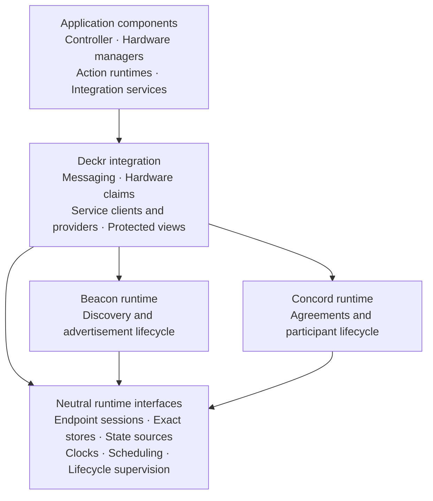
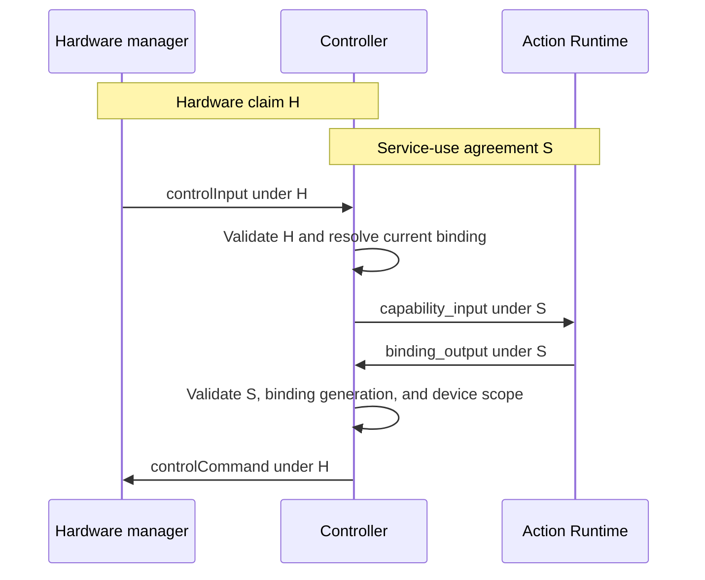

# Deckr architecture proposal for v1

## Informative status and scope

**This document is informative, not normative.** It proposes a baseline
architecture for applications that use the Beacon, Concord, and Deckr v1
contracts. It adds no wire contracts or conformance requirements.

Implementations can use a different architecture. They can choose their
programming language, APIs, packages, process layout, and deployment tools.
The applicable schemas, normative specifications, and semantic rules remain
authoritative. A different architecture does not change those requirements.
If this proposal conflicts with a normative contract, that contract takes
precedence.

The baseline has two independent protocol runtimes, a Deckr integration layer,
and application components with explicit state and lifecycle owners. Its purpose
is to make those boundaries clear across implementation languages.
The tables and diagrams describe logical responsibilities. They do not prescribe
classes, interfaces in a particular language, or separate network services.

## Repository responsibilities

The [project repository map](../README.md#project-repositories) identifies the
reference repository, three language cores, and the integration harness.
This reference repository owns the contracts and this informative proposal.
Each core owns its reusable implementation and its language-specific API.
Application repositories own the controller, device drivers, action behavior,
and external integrations.

The integration harness uses the cores' public managed APIs in test applications.
It checks selected cross-language workloads against a real broker. It does not
replace the reference conformance scenarios or supply a production application.
Each core documents its own implementation coverage; this proposal does not
assert API or feature parity between languages.

## Terms and boundaries

| Term | Meaning in this proposal |
| --- | --- |
| Component | A logical unit with a defined responsibility and lifecycle. |
| Runtime | Components that manage protocol state and background work within a process. |
| Host | The part of an implementation that creates components and supplies their resources. |
| Adapter | A component that connects a runtime interface to a concrete store, transport, device, or backend. |
| Managed boundary | A component that owns protocol work and checks authority before application work proceeds. |
| Service | A provider exposed through a declared Deckr service protocol. |

An internal component does not need a service endpoint. For example, controller
settings and page management can use local interfaces. Exposing either component
as a network service needs a separately defined contract.

An endpoint identifies a participant. An endpoint session identifies one runtime
instance of that endpoint. A process can host several endpoints. A process
boundary alone does not define an agreement or grant authority.

## Dependency structure

Arrows in this diagram mean that one logical component depends on another.
They do not show message flow or process boundaries.

The host supplies concrete adapters to these interfaces. Beacon and Concord
have no dependency on each other or on Deckr. A different application can use
either protocol with its own profiles and endpoint policy.

| Part | Responsibility | Boundary |
| --- | --- | --- |
| Host and infrastructure | Configuration, connections, store access, endpoint sessions, scheduling, supervision, and diagnostics. | Supplies resources. Application and protocol components decide how those resources are used. |
| Beacon runtime | Advertisement publication, refresh, withdrawal, candidate selection, and discovery views. | Returns candidates. Agreement negotiation belongs to a consumer of Beacon. |
| Concord runtime | Contract evaluation, proposals, participation, token renewal, local authority, and guarded cleanup. | Evaluates generic agreements. Profile owners define device and service semantics. |
| Deckr integration | Endpoint policy, envelopes, lanes, hardware and service profiles, managed clients and providers, and protected views. | Composes Beacon and Concord and applies Deckr rules. |
| Application components | Devices, actions, routing, pages, settings, integrations, and user interaction. | Supply domain behavior and policy through managed boundaries. |

The `protocol-common` schemas retain their existing neutral data definitions.
An implementation can share runtime utilities in a separate module. That choice
does not add runtime concepts to the protocol-common wire contract.

## Host and infrastructure

The host creates components, supplies their dependencies, and owns their outer
lifetime. Components receive the capabilities they need. For example, a device
driver receives device operations and event reporting. It does not need a raw
Concord token store.

The baseline separates these infrastructure capabilities:

| Capability | Information and operations |
| --- | --- |
| Endpoint session | Stable endpoint address, current session identity, and local subscription lifetime. |
| Exact store | Exact reads, create, revision-guarded update and delete, committed revisions, and store TTL metadata. |
| Materialized source | Ordered observations, immutable snapshots, snapshot completion, revisions, source generations, and currentness. |
| Time and scheduling | UTC timestamps, local deadlines, scheduled work, jitter, and cancellation. |
| Lifecycle supervision | Worker ownership, failure reporting, and bounded closure. |
| Diagnostics | Structured reasons, state transitions, resource counts, and correlation data. |

Exact stores and materialized sources have separate responsibilities. Store
mutations return revisions. Ordered watch observations update sources. A local
write does not directly replace the source snapshot. This preserves the behavior
specified in [Deckr NATS binding](deckr-nats-binding.md#8-materialized-sources-and-recovery).

A NATS implementation can share its connection and storage machinery across
protocol runtimes. Its generic store adapter handles revisions, TTL policy, and
watch recovery. Its Deckr lane adapter handles Deckr subjects, headers, and
message delivery. The host supplies the concrete store names from the
[Deckr NATS binding](deckr-nats-binding.md#protocol-store-bindings).

These internal interfaces permit implementation separation. They do not establish
conformance for a different transport. A different binding needs to preserve the
applicable protocol behavior and specify its interoperability rules.

## Independent protocol runtimes

### Beacon runtime

The Beacon runtime exposes managed advertisement lifetimes and a discovery view.
It owns refresh scheduling, owner checks, withdrawal, and discovery recovery.
Application profiles validate the meaning of advertisement payloads.

Consumers share the managed view within the runtime. Queries select candidates
from cached state. The higher Deckr layer interprets hardware or service
descriptors and decides which candidates to try.

Advertisement withdrawal, expiry, or loss of Beacon currentness affects
discovery. The existing agreement follows its own authority checks. This is the
[Beacon discovery boundary](beacon.md#3-discovery-boundary).

### Concord runtime

The baseline separates Concord into three components:

| Component | Responsibility |
| --- | --- |
| Evaluator | Takes fixed observations and session assertions. Returns validity, parsed records, and structured reasons without I/O or mutation. |
| Managed lifecycle | Owns local handles, attachment, participant selection, token renewal, authority termination, and cleanup. |
| Optional maintenance | Uses dedicated store capabilities for stale-contract cancellation and retained-record cleanup. |

Cached and exact validation feed observations into the same evaluation rules.
The lifecycle component separately tracks whether the local agreement has lost
authority. A later valid record observation does not restore terminated local
authority. See [Concord validation](concord.md#12-contract-validation) and
[permanent loss of authority](concord.md#9-permanent-loss-of-authority).

A proposal lifetime owns one agreement. The higher managed client owns the
decision to negotiate a successor. Token renewal workers only maintain tokens
whose exact handles the runtime holds.

Maintenance has a separate lifetime and access path. Ordinary participation has
no maintenance readiness dependency. The reaper uses Concord records for its
decisions. See [Concord maintenance](concord.md#15-concord-maintenance).

### Shared runtime resources

The baseline embeds Beacon and Concord in participating processes. It does not
require a central discovery daemon or agreement daemon. The shared stores hold
the protocol records.

Within each runtime, logical consumers share managed protocol views and their
underlying sources. Endpoint lifetimes retain separate ownership of their
advertisements, tokens, and subscriptions. Sharing stops at the applicable
connection, access, and lifecycle boundaries.

## Deckr integration

Deckr integration combines protocol capabilities with application profiles.
It provides the following managed components:

| Component | Responsibility |
| --- | --- |
| Messaging | Envelope validation, lane rules, endpoint and session delivery, expiry, and request/reply correlation. |
| Hardware client | Hardware discovery, claim negotiation, descriptor validation, and authorized hardware operations. |
| Hardware manager boundary | Bootstrap, claim admission, capacity checks, device-change consequences, and authorized driver dispatch. |
| Service client | Descriptor validation, candidate selection, negotiation races, successor negotiation, authorized messages, and protected view access. |
| Service provider boundary | Bootstrap, participation, operation validation, protected view publication, and backend lifecycle. |
| Action Runtime support | Action protocol validation, availability, lifecycle messages, and action, binding, and page references. |

The hardware components compose the hardware Beacon and Concord profiles.
The service components compose the service declaration, advertisement profile,
service-use profile, and view families. Action Runtime support builds on those
service components and the Deckr hardware capability definitions.

Application handlers receive operations limited to their current managed
context. The context retains the exact agreement and session identity. Before
protected work proceeds, it checks local authority and the applicable message,
profile, and resource rules. A stored handle alone does not grant authority.

For example, a device driver reports a disconnection. The hardware manager
boundary applies the claim-termination rules. A backend can withdraw domain
consent. Its service provider boundary applies that decision through Concord.
Protocol termination does not wait for an application callback.

These divisions implement the existing
[managed lifecycle requirements](deckr-messaging.md#managed-lifecycle-boundaries).
The [managed service client](deckr-services.md#managed-service-consumers) owns
shared feature discovery, negotiation limits, winner selection, and recovery.
Application handlers supply domain policy without classifying Concord statuses
or maintaining a second authority registry.

## Application components and state ownership

The baseline assigns each type of state to one logical owner.

| Component | Owned state and behavior | Suggested placement |
| --- | --- | --- |
| Controller | Action-instance, binding, and page-session identities; routing; settings placement; output generations. | One logical owner for each controlled scope. |
| Hardware manager | Device connections, descriptors, capability values, and device commands. | Near the hardware. |
| Action Runtime | Action behavior, availability, lifecycle and input handling, and output requests. | Embedded or in a separate process. |
| Integration service | External-system connections, domain operations, and service-owned state and views. | Separate when sharing or isolation is useful. |
| Configuration and persistence | Desired layouts, saved settings, and user choices. | Initially within the controller. |
| User interface | Configuration editing and presentation of application state. | Optional frontend. |
| Diagnostics | Component state, failures, resource counts, and lifecycle evidence. | Host facility with component contributions. |

A hardware-backed action path uses a controller, hardware manager, and Action
Runtime. External integrations are included when actions need them. An
interactive user interface and the Concord reaper are optional components.

An Action Runtime exposes the existing service endpoint
`service:action-runtime.<providerInstanceId>`. Its role name does not create a
different endpoint or lane. See [Deckr Action Runtime](deckr-action-runtime.md).

### Controller components

The controller separates five internal responsibilities:

| Responsibility | Work |
| --- | --- |
| Capability matching | Resolve action requirements against negotiated device descriptors. |
| Action and binding lifecycle | Allocate identities and maintain their relationship to current agreements. |
| Page management | Allocate page sessions and resolve dynamic child bindings. |
| Settings management | Resolve settings targets and supply the applicable snapshots. |
| Output routing | Check binding generations and scope, then produce hardware commands. |

These components can use local interfaces in one process. The existing schemas
do not define a general configuration API, settings API, or rendering service.
A component exposed through a new wire API needs a contract defined before its
implementation, as described in the [schema guide](schema-guide.md).

### Durable and runtime state

Durable configuration records desired state. The controller restores that intent
and negotiates the agreements needed to use it. Restored configuration does not
restore token ownership or live routing authority.

Concord owns agreement records and participant tokens. Beacon owns advertisement
records. Protected service views carry service data with the required agreement
and session fences. Package-owned stores hold permitted durable state and
projections under the [Deckr identifier policy](deckr-identifiers.md#8-private-storage).

Controllers resolve unknown extension capabilities through their descriptors.
Interpretation of extension values belongs to components that know the owning
contract. See [Deckr hardware capabilities](deckr-hardware-capabilities.md#descriptor-driven-extensibility).

## Example of input and output routing

The controller connects two independently authorized relationships. In this
example, H is a hardware claim and S is an Action Runtime service-use agreement.
Each label represents its own exact contract pointer.

Each receiver checks its incoming message and authority. The Action Runtime
service agreement does not grant hardware ownership. The controller validates
the output request and resolves its current binding. It then issues a separate
hardware command through the hardware claim.

The hardware command carries H, not S. A valid S does not replace validation of
H. Binding and page identities do not replace either agreement. The
[action routing rules](semantic-rules.md#sem-act-002-requirements-and-routing)
define the applicable scope and generation checks.

If an action uses an integration service, that interaction has its own
service-use agreement and domain scope.

## Lifecycle and recovery

### Startup and readiness

Each managed component exposes immutable state, current-state watches,
structured failures, and explicit closure. Each background worker has a lifecycle
owner. The language-specific resource-management API is an implementation choice.

A typical startup sequence is:

1. The host opens connections and checks the required store policies.
2. Protocol sources establish current snapshots.
3. Providers and managers complete bootstrap checks and prepare their handlers.
4. Eligible providers publish advertisements.
5. Consumers discover candidates and negotiate agreements.
6. The controller activates routes whose dependencies have authority.

This sequence applies to each component's dependencies. Readiness is reported
per component and operation. One unavailable integration need not prevent
unrelated hardware and actions from operating.

### Failure boundaries

The following table summarizes behavior from the linked normative sources.
It does not define additional failure or recovery rules.

| Event | Effect and recovery | Source |
| --- | --- | --- |
| Beacon becomes stale or an advertisement disappears. | Discovery is affected. Existing agreements continue while their authority checks pass. | [Beacon discovery boundary](beacon.md#3-discovery-boundary). |
| A Concord authority source becomes stale or a required heartbeat fails. | Affected local authority ends permanently. Remote cleanup failure does not delay local termination. | [Concord authority loss](concord.md#9-permanent-loss-of-authority). |
| Transport reconnects after local authority loss. | Sources rebuild. Authority requires a new opaque contract ID and generation 1. | [Concord recovery](concord.md#94-recovery). |
| A protected service-view source becomes stale. | The source reports stale state and rebuilds its snapshot. Concord authority is assessed separately. | [Source currentness](deckr-nats-binding.md#82-currentness) and [protected views](deckr-services.md#protected-service-views). |
| A claimed device disconnects or its descriptor changes materially. | The hardware profile boundary applies the specified claim termination and discovery behavior. | [Hardware device changes](deckr-hardware.md#device-changes). |

In the baseline, a managed client negotiates a successor when its policy and
the protocol permit recovery. It does not replay published commands under a
different agreement. The controller establishes new authorized routing state
before it sends new work.

### Shutdown

The host closes dependent components before shared infrastructure. Managed
boundaries stop protected work, cancel private workers, and perform cleanup
with the specified identity checks and revision guards. Closing the transport
last gives those components an opportunity to complete remote cleanup.

The [Concord context lifecycle](concord.md#132-context-entry-and-exit) gives the
remote-cleanup time limit. The [Beacon lifecycle](beacon.md#6-advertisement-lifecycle)
governs advertisement withdrawal. Closing an endpoint session alone does not
perform either protocol's cleanup.

## Deployment choices

For an initial implementation, the controller and its internal components can
share one process. Hardware managers, Action Runtimes, and integration services
can be embedded or separately hosted. Hardware location, dependencies, resource
use, and failure isolation guide that choice.

| Deployment | Composition |
| --- | --- |
| Compact application | One host creates the application components and shares protocol runtimes and infrastructure. |
| Distributed installation | Each process hosts its roles and managed runtimes. Participants use the agreed shared stores and transport binding. |
| Embedded integration | Another application supplies the host lifetime and resources. Managed boundaries retain their protocol responsibilities. |

Local delivery retains the canonical logical messages and authority checks.
Moving a component into the same process does not change the meaning of its
contracts. Moving an internal component onto a network needs an explicit wire
contract. The [Deckr deployment guide](deckr-deployment.md) gives the existing
deployment responsibilities.

## Relationship to the reference contracts

The baseline adds no schemas, message names, bucket assignments, or conformance
tests. Its component boundaries are recommendations. The linked specifications
define the behavior that implementations demonstrate through the existing
[semantic rules](semantic-rules.md) and
[Deckr conformance scenarios](../deckr-conformance-scenarios.md).

Implementations can test protocol evaluators with fixed observations and test
managed lifetimes with controlled clocks, stores, and watch failures. Their
runtime checks remain in their implementation repositories. The reference
repository's structural validation does not prove runtime authority or lifecycle
conformance.

The current generic protocol documents refer to shared storage and watch rules
in the Deckr NATS binding. A future documentation change could extract those
shared rules into a neutral substrate document. Concrete Deckr store names and
lane mappings would remain in the Deckr binding. Such a change would need its
own review; this proposal does not move or replace the current rules.
