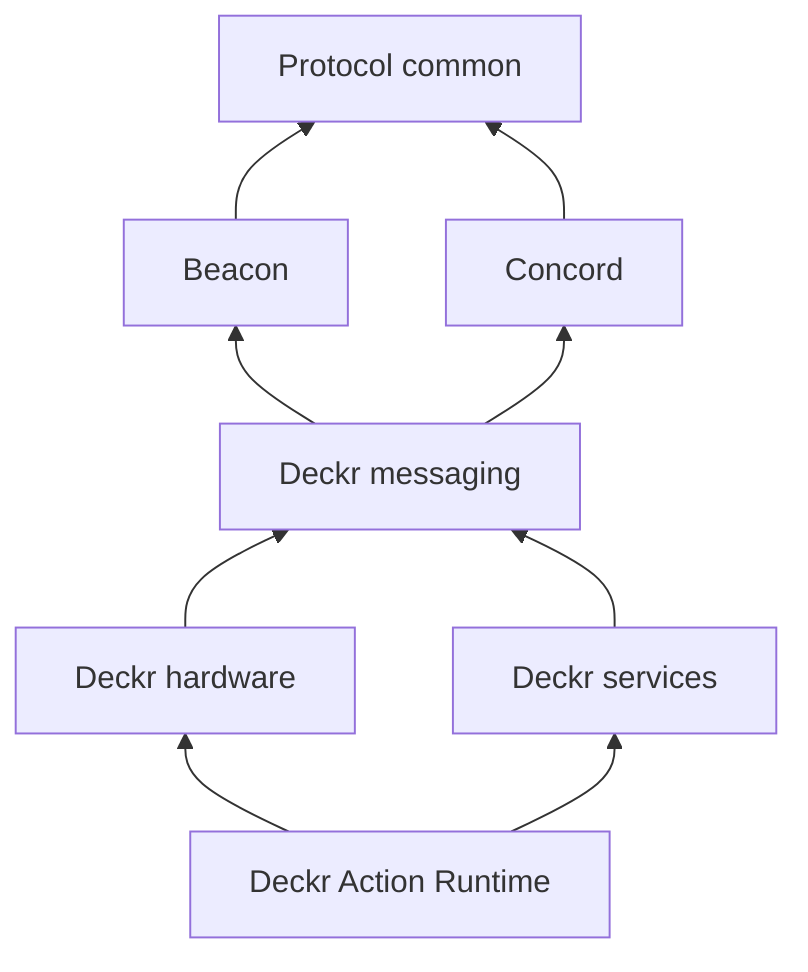

# Deckr messaging v1 specification

This document specifies the application wire boundary. Runtime APIs, language
class layouts, process launchers, component discovery mechanisms and configuration
loaders are implementation choices outside this reference repository.

## Protocol layers

Beacon supplies discovery candidates. Concord supplies live agreement authority.
Deckr supplies addressing policy, lane messages and domain payloads. A valid
advertisement does not grant authority; a valid JSON contract does not prove that
its participant tokens are current. A transport must carry the canonical logical
message unchanged.

Arrows mean schema dependencies. Protocols never reference Deckr application types.

## Endpoint identity

Deckr constrains the generic `<family>:<id>` endpoint syntax to `controller`,
`hardware_manager`, `action_provider` and `service`. The endpoint ID is nonempty,
un-padded and contains no colon. Action-provider IDs match
`[A-Za-z0-9][A-Za-z0-9._-]*`; `dev.deckr.controller.builtin` is reserved as an
action-provider endpoint. These restrictions are in the Deckr endpoint schema,
not the generic protocols. Other applications can use families such as `worker`.

An endpoint's session ID distinguishes runtime incarnations. Device, control,
capability, action, binding and page IDs identify subjects or domain state;
they are not transport addresses or substitutes for session/contract identity.

## Envelope

The [message schema](../contract/v1/schemas/deckr/messaging/message.v1.schema.json)
defines the reusable envelope. Complete lane schemas constrain it further.

| Fields | Meaning |
| --- | --- |
| `messageId`, `protocolVersion`, `schemaVersion` | Message identity and wire version metadata; protocol version is `1`. |
| `lane`, `messageType` | Logical delivery lane and lane-level discriminator. |
| `sender`, `senderSessionId` | Sending endpoint and its runtime incarnation. |
| `recipient`, `recipientSessionId` | Direct endpoint or permitted broadcast target; a recipient session is allowed only for direct delivery. |
| `contract` | Exact Concord `contractId` and positive `generation` authorizing a protected message. |
| `subject` | Entity kind and application identifiers. |
| `createdAt`, `expiresAt`, `ttlMs` | UTC/RFC 3339 creation/expiry data and optional nonnegative TTL. |
| `inReplyTo`, `causationId`, `trace` | Correlation, causation and tracing metadata. |
| `body` | Typed lane body, further constrained by the application protocol. |

### Message identity

Every message carries a nonempty `messageId` and a `createdAt` timestamp, supplied
by its producer. Receivers must not generate missing values.

### Message expiry

The effective expiry is the earlier of `expiresAt` and `createdAt + ttlMs`, when
both are present. Expired messages must not be delivered as current work.
Receivers must not substitute their receive time.

### Reply acceptance

A reply must satisfy these conditions:

- Its `messageId` differs from the request `messageId`.
- Its `inReplyTo` equals the request `messageId`.
- Its contract pointer equals the request contract pointer.
- Its endpoint sessions match the expected sessions, when supplied.

The [Deckr NATS binding](deckr-nats-binding.md#62-requests-and-replies)
defines reply delivery, acceptance, and timeout cleanup for NATS.

## Core lane registry

| Lane | Senders / direct recipients | Broadcasts | Concord pointer |
| --- | --- | --- | --- |
| `hardware_messages` | `controller`, `hardware_manager` | `controllers` scope with `controller` family; default hop limit 1 | Required for all eight message types |
| `services` | `controller`, `action_provider`, `service` | None | Required |

Action Runtime uses
`services` / `serviceMessage`; its discriminator is `body.name` under
`body.serviceNamespace = dev.deckr.action_runtime.provider`.

See the [Deckr message catalog](deckr-message-catalog.md) for exact message schemas. Action
Runtime messages are direct, session-fenced, one-way service messages. Lifecycle
and input events use `body.event`; commands use `body.params`. A generic service
message may be request/reply, with application-declared result/error shapes.

## Message contract rule

Before a protected operation, complete these checks:

- Validate the complete message against its lane and application schemas.
- Validate the exact Concord contract pointer.
- Validate the current participant tokens.
- Check the sender and recipient sessions.
- Apply the profile checks for devices, actions, bindings, resources, and output generations.

Do not search for a different matching contract to authorize a message.

Core lane traffic has the same logical shape whether transported locally or over
a broker. NATS subjects and headers are routing hints; they never replace envelope
validation. Transport adapters must not invent alternate core payload shapes.

## Extension messages

An extension uses an owner-controlled service namespace, application schema IDs,
and a service protocol declaration, or a separately specified extension lane.
It must not redefine core messages. Service-specific data such as media zones or
home-automation items belongs to the owning service, not Beacon or Concord.

## Reference roles and lifecycle

| Role | Responsibility |
| --- | --- |
| Controller | Owns routing, bindings, settings placement, and dynamic page identity. |
| Hardware manager | Owns descriptors and hardware behavior. |
| Action runtime | Exposes actions and processes lifecycle and input messages. |
| Service provider | Owns its service protocol and views. |
| Host | Supplies transport, shared stores, and lifecycle supervision. |

Shutdown closes subscriptions and relinquishes owned advertisements/tokens with
identity checks and revision guards. Missing discovery does not terminate an
already-valid agreement. Required detailed lifecycle behavior is in
[Beacon](beacon.md), [Concord](concord.md), [Deckr hardware](deckr-hardware.md),
[Deckr services](deckr-services.md), and [the Deckr NATS binding](deckr-nats-binding.md).
These requirements apply to each implementation framework.

### Managed lifecycle boundaries

Service providers and hardware managers require managed lifecycle boundaries.
These boundaries own these operations:

- Owner bootstrap.
- Participant selection.
- Private worker control.
- Authorization.
- Advertisement publication after bootstrap.
- Cleanup within the required time limits.

Application code supplies protocol intent, backend or device behavior, and domain
policy. The managed lifecycle boundaries own token refresh, reconciliation,
contract retries, background workers, and raw contract pointers. Application code
does not manage those operations itself.

Application code supplies domain facts, such as device connection changes and
backend availability. Profile implementations must validate profile data and
apply the specified consequences of those facts. Generic Concord must validate
contract and token identity, session assertions, and authority.

Application policy must not replace these checks. It must not maintain accepted
contract sets in response to Concord validity transitions. Managed contexts must
enforce local authority before protected operations. They must initiate required
protocol termination and cleanup without an application or operator request.
Local authority loss must not wait for a domain callback.
